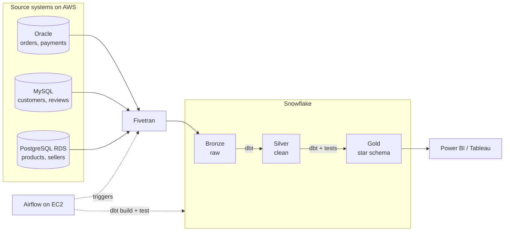

# Klarity
end-to-end data engineering platform designed to eliminate operational data silos and transform chaotic, messy source data into clear, trusted business intelligence# Klarity
end-to-end data engineering platform designed to eliminate operational data silos and transform chaotic, messy source data into clear, trusted business intelligence

> End-to-end data platform: Oracle, MySQL and PostgreSQL → Fivetran → Snowflake (Bronze / Silver / Gold) → dbt → Airflow → Dashboard.

## 1. Business problem

A fictional retailer keeps orders in Oracle, customers in MySQL and products in PostgreSQL, so nobody can answer questions such as "what is revenue by month and category?". This project delivers one governed platform that copies all three systems into Snowflake, cleans and models the data with dbt, refreshes nightly with Airflow, and serves a dashboard.

Data: the public [Olist Brazilian e-commerce dataset](https://www.kaggle.com/datasets/olistbr/brazilian-ecommerce) (about 100k orders, 9 CSV files), split across the three source databases to simulate the company.

## 2. Architecture



| Layer | Built by | Rule |
| --- | --- | --- |
| Bronze | Fivetran | Exact copy of sources. Never edited by hand. |
| Silver | dbt (`stg_` models) | Typed, deduplicated, standardised. One row per business key. |
| Gold | dbt (marts) | Star schema and KPI tables. The only layer dashboards read. |

## 1. What the project is about

A fictional retailer keeps its data in three separate systems:

| System | Holds |
| --- | --- |
| Oracle | orders, order_items, order_payments |
| MySQL | customers, order_reviews |
| PostgreSQL (AWS RDS) | products, sellers, category_translation, geolocation |

Because the data is split, nobody can answer simple questions such as "what is revenue by month and category?". This project builds one governed data platform that:

1. copies all three systems into Snowflake automatically,
2. cleans and models the data with dbt,
3. refreshes every night with Airflow,
4. serves a dashboard to business users.

**Data:** the public [Olist Brazilian e-commerce dataset](https://www.kaggle.com/datasets/olistbr/brazilian-ecommerce) (about 100k orders, 9 CSV files), split across the three databases to simulate a real company. A script (`daily_changes.py`) simulates daily activity and injects realistic dirty data (duplicates, mixed-case text, negative prices, orphan orders) so the cleaning work is real.

Credit: Olist, licensed CC BY-NC-SA 4.0. The CSV files are not stored in this repo.

**How it is run:** like a client project. There is a charter, agreed requirements, architecture decisions, two-week sprints with demos, a Kanban board, pull requests with CI, a UAT and handover phase, and a client sign-off at the end. The "client" is the mentor.

## 2. Requirements

Full text: [`docs/01-requirements.md`](docs/01-requirements.md) (version 2, revised after mentor feedback on 4 Nov, awaiting approval).

### Business questions (these drive the Gold layer)

1. What is revenue by month and category, and how fast is it growing (MoM, YoY, 3-month moving average)?
2. Which categories and products drive the most revenue, and how concentrated is revenue (Pareto)?
3. Which sellers deliver late, how late, and where in the journey is the delay?
4. How does delivery delay affect review scores, by category and seller?
5. How many new customers per month, where are they, and do they come back?
6. Do customers return? Cohort retention by first-order month.
7. What is customer lifetime value by cohort, and who are the top segments (RFM)?
8. Which sellers should be rewarded or put on watch (scorecard with a tier)?
9. How do payment method and instalments affect order value and cancellations?
10. Is the platform data healthy right now (freshness, reconciliation, quality)?

### KPIs

| Tier | KPIs |
| --- | --- |
| 1 Business | GMV, net revenue, average order value, revenue growth (MoM, YoY, moving average), cancellation rate, freight ratio, average instalments |
| 2 Customer | new customers, repeat purchase rate, cohort retention, cohort lifetime value, RFM segment |
| 3 Operations and sellers | on-time delivery rate, delay days (P50, P90), lead-time breakdown, delay vs review score, seller scorecard and tier, seller concentration, seller-customer distance |
| 4 Pipeline health | data freshness, reconciliation pass rate, test pass rate, quarantined rows, nightly run time and success |

Definitions and grain for every KPI are in `docs/01-requirements.md`. Conversion, cart abandonment, CAC and margin are out of scope because Olist has no sessions, marketing spend, costs or returns.

### Reporting layer

Near real time, not streaming. The simulator can run every few minutes, Fivetran syncs at the shortest interval the plan allows, and Gold refreshes incrementally. Target: 15 minutes or less from a source change to the dashboard, measured and shown on the Data Health page.

### Non-functional requirements

- Nightly full refresh plus intraday incremental refresh, with an alert if Bronze is older than 24 hours
- Dashboard reads only the Gold layer, through a read-only role
- No credentials in code or in Git
- Everything rebuildable from Bronze
- Low cost: budget alerts, auto-suspend, stop idle servers

## 3. Deliverables

| # | Deliverable | Status |
| --- | --- | --- |
| 1 | Three populated source databases with daily change simulator | ☐ |
| 2 | Automated ingestion into Snowflake Bronze, reconciled | ☐ |
| 3 | Tested and documented Silver and Gold layers (dbt) | ☐ |
| 4 | Nightly orchestrated pipeline with alerting (Airflow) | ☐ |
| 5 | CI/CD on GitHub Actions, secrets in AWS SSM | ☐ |
| 6 | Business dashboard (revenue, categories, seller delivery, reviews) | ☐ |
| 7 | Handover pack: runbook, data dictionary, architecture, cost report | ☐ |

## 4. Tech stack

Oracle XE · MySQL 8 · PostgreSQL (AWS RDS) · Docker · Fivetran · Snowflake · dbt Core · Apache Airflow · GitHub and GitHub Actions · AWS (EC2, RDS, SSM, IAM) · Power BI or Tableau · DBeaver

## 5. Tools explained: DBeaver and dbt

**DBeaver is a window into your databases. dbt is a factory that builds tables inside one.** You look with DBeaver and build with dbt.

| | DBeaver | dbt |
| --- | --- | --- |
| What it is | Free desktop SQL client | Command-line transformation tool |
| How you use it | By hand, one query at a time | As code in Git, repeatable, run by Airflow |
| Changes data | Only if you type write SQL | Yes, it builds the Silver and Gold tables |
| Typical actions | Connect, query, ER diagram, export | `dbt debug`, `dbt build`, `dbt test`, `dbt docs serve` |
| Used in | Sprints 1 and 2, then for debugging | Sprints 3 and 4 |

- **DBeaver** connects to Oracle, MySQL, PostgreSQL and Snowflake in one app. It stores and transforms nothing.
- **dbt** turns a plain `SELECT` in a `.sql` file (a *model*) into a table or view, works out the run order from `ref()` and `source()`, runs tests and generates documentation and lineage. It does not extract data (Fivetran does) and has no scheduler (Airflow does). We use dbt Core (free).

Key dbt words: **model** (one SQL file = one table), **source** (a raw table dbt reads but does not own), **test** (a rule such as `unique` or `not_null`), **materialization** (view, table or incremental).

## 6. Milestones and releases

| Release | Milestone | Sprint | Date |
| --- | --- | --- | --- |
| v0.1 | Sources ready: three databases loaded and profiled | 1 | 13 Nov 2026 |
| v0.2 | Bronze live: all sources land in Snowflake and reconcile | 2 | 27 Nov 2026 |
| v0.3 | Silver and Gold: `dbt build` green with tests and docs | 3 | 11 Dec 2026 |
| v1.0 | Delivered: automated pipeline, dashboard, client sign-off | 4 | 25 Dec 2026 |

Each release is a GitHub **Milestone** and a Git tag (`git tag v0.1.0 && git push --tags`).

## 5. Repository structure

```text
Klarity/
├── README.md
├── CONTRIBUTING.md          <- branching, commits, PR rules, Definition of Done
├── .github/                 <- CI workflow, PR and issue templates, CODEOWNERS
├── docs/                    <- charter, requirements, architecture, sprint plan, runbook, ADRs, jira-backlog
├── sources/                 <- loading and change-simulation scripts for the 3 source DBs
├── sql/                     <- profiling and reconciliation queries
├── dbt/                     <- Silver (models/staging) and Gold (models/marts)
├── airflow/                 <- DAGs
├── infra/                   <- AWS and Snowflake setup (aws/, snowflake/)
├── scripts/                 <- helper scripts
├── tests/                   <- Python tests
├── .env.example             <- variable names only, never real values
└── requirements.txt
```

## 6. Delivery plan

| Sprint | Dates | Goal | Release |
| --- | --- | --- | --- |
| 1 | 2-13 Nov | Repo and AWS secure, requirements agreed, three sources loaded and profiled | v0.1 Sources ready |
| 2 | 16-27 Nov | Sources land in Snowflake Bronze, copy proven correct | v0.2 Bronze live |
| 3 | 30 Nov-11 Dec | dbt builds tested, documented Silver and Gold | v0.3 Silver and Gold |
| 4 | 14-25 Dec | Automated pipeline, dashboard, handover and sign-off | v1.0 Delivered |


## 7. Getting started

Prerequisites: Git, Python 3.11+, Docker Desktop, AWS CLI v2.

```bash
git clone <repo-url> && cd retail-de-project
python -m venv .venv
source .venv/bin/activate          # Windows: .venv\Scripts\Activate.ps1
pip install -r requirements.txt
cp .env.example .env               # fill in values, never commit .env
```

Run instructions for each component are added to that folder's README as its sprint completes.

## 8. Environments

| Environment | Where | Purpose |
| --- | --- | --- |
| dev | personal Snowflake schema `dbt_<name>` | development |
| ci | temporary schema per pull request | automated checks |
| prod | `SILVER` and `GOLD` databases | built nightly by Airflow |

## 9. Security and cost rules

- Brand-new AWS account, MFA on root, budget alerts, all resources tagged `project=retail-de`
- No secrets in Git: `.env` locally, SSM Parameter Store with an IAM role in AWS, GitHub Secrets in CI
- Least privilege: `LOADER` writes Bronze, `TRANSFORMER` builds Silver and Gold, `REPORTER` reads Gold only
- No database open to `0.0.0.0/0`
- Stop EC2 when idle. Full cleanup at project end (see runbook)


## 11. Acceptance criteria

- [ ] Insert a row at the source, run the pipeline, see it on the dashboard
- [ ] Row counts reconcile source to Bronze; Gold totals match source queries
- [ ] `dbt build` and `dbt test` are green
- [ ] Nightly schedule runs and alerts on failure
- [ ] No secrets in the repo, no database exposed to the internet
- [ ] Runbook and data dictionary complete
- [ ] Cloud spend within the agreed budget
