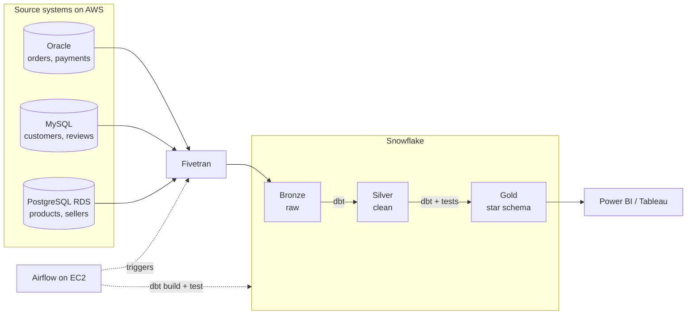

# Klarity
end-to-end data engineering platform designed to eliminate operational data silos and transform chaotic, messy source data into clear, trusted business intelligence# Klarity
end-to-end data engineering platform designed to eliminate operational data silos and transform chaotic, messy source data into clear, trusted business intelligence

> End-to-end data platform: Oracle, MySQL and PostgreSQL → Fivetran → Snowflake (Bronze / Silver / Gold) → dbt → Airflow → Dashboard.

## 1. Business problem

A fictional retailer keeps orders in Oracle, customers in MySQL and products in PostgreSQL, so nobody can answer questions such as "what is revenue by month and category?". This project delivers one governed platform that copies all three systems into Snowflake, cleans and models the data with dbt, refreshes nightly with Airflow, and serves a dashboard.

Data: the public [Olist Brazilian e-commerce dataset](https://www.kaggle.com/datasets/olistbr/brazilian-ecommerce) (about 100k orders, 9 CSV files), split across the three source databases to simulate the company.

## 2. Architecture



| Layer | Built by | Rule |
| --- | --- | --- |
| Bronze | Fivetran | Exact copy of sources. Never edited by hand. |
| Silver | dbt (`stg_` models) | Typed, deduplicated, standardised. One row per business key. |
| Gold | dbt (marts) | Star schema and KPI tables. The only layer dashboards read. |

## 3. Deliverables

| # | Deliverable | Status |
| --- | --- | --- |
| 1 | Three populated source databases with daily change simulator | ☐ |
| 2 | Automated ingestion into Snowflake Bronze, reconciled | ☐ |
| 3 | Tested and documented Silver and Gold layers (dbt) | ☐ |
| 4 | Nightly orchestrated pipeline with alerting (Airflow) | ☐ |
| 5 | CI/CD on GitHub Actions, secrets in AWS SSM | ☐ |
| 6 | Business dashboard (revenue, categories, seller delivery, reviews) | ☐ |
| 7 | Handover pack: runbook, data dictionary, architecture, cost report | ☐ |

## 4. Tech stack

Oracle XE · MySQL 8 · PostgreSQL (AWS RDS) · Docker · Fivetran · Snowflake · dbt Core · Apache Airflow · GitHub and GitHub Actions · AWS (EC2, RDS, SSM, IAM) · Power BI or Tableau · DBeaver 

## 5. Repository structure

```text
Klarity/
├── README.md
├── CONTRIBUTING.md          <- branching, commits, PR rules, Definition of Done
├── .github/                 <- CI workflow, PR and issue templates, CODEOWNERS
├── docs/                    <- charter, requirements, architecture, sprint plan, runbook, ADRs, jira-backlog
├── sources/                 <- loading and change-simulation scripts for the 3 source DBs
├── sql/                     <- profiling and reconciliation queries
├── dbt/                     <- Silver (models/staging) and Gold (models/marts)
├── airflow/                 <- DAGs
├── infra/                   <- AWS and Snowflake setup (aws/, snowflake/)
├── scripts/                 <- helper scripts
├── tests/                   <- Python tests
├── .env.example             <- variable names only, never real values
└── requirements.txt
```

## 6. Delivery plan

| Sprint | Dates | Goal | Release |
| --- | --- | --- | --- |
| 1 | 2-13 Nov | Repo and AWS secure, requirements agreed, three sources loaded and profiled | v0.1 Sources ready |
| 2 | 16-27 Nov | Sources land in Snowflake Bronze, copy proven correct | v0.2 Bronze live |
| 3 | 30 Nov-11 Dec | dbt builds tested, documented Silver and Gold | v0.3 Silver and Gold |
| 4 | 14-25 Dec | Automated pipeline, dashboard, handover and sign-off | v1.0 Delivered |


## 7. Getting started

Prerequisites: Git, Python 3.11+, Docker Desktop, AWS CLI v2.

```bash
git clone <repo-url> && cd retail-de-project
python -m venv .venv
source .venv/bin/activate          # Windows: .venv\Scripts\Activate.ps1
pip install -r requirements.txt
cp .env.example .env               # fill in values, never commit .env
```

Run instructions for each component are added to that folder's README as its sprint completes.

## 8. Environments

| Environment | Where | Purpose |
| --- | --- | --- |
| dev | personal Snowflake schema `dbt_<name>` | development |
| ci | temporary schema per pull request | automated checks |
| prod | `SILVER` and `GOLD` databases | built nightly by Airflow |

## 9. Security and cost rules

- Brand-new AWS account, MFA on root, budget alerts, all resources tagged `project=retail-de`
- No secrets in Git: `.env` locally, SSM Parameter Store with an IAM role in AWS, GitHub Secrets in CI
- Least privilege: `LOADER` writes Bronze, `TRANSFORMER` builds Silver and Gold, `REPORTER` reads Gold only
- No database open to `0.0.0.0/0`
- Stop EC2 when idle. Full cleanup at project end (see runbook)


## 11. Acceptance criteria 

- [ ] Insert a row at the source, run the pipeline, see it on the dashboard
- [ ] Row counts reconcile source to Bronze; Gold totals match source queries
- [ ] `dbt build` and `dbt test` are green
- [ ] Nightly schedule runs and alerts on failure
- [ ] No secrets in the repo, no database exposed to the internet
- [ ] Runbook and data dictionary complete
- [ ] Cloud spend within the agreed budget


