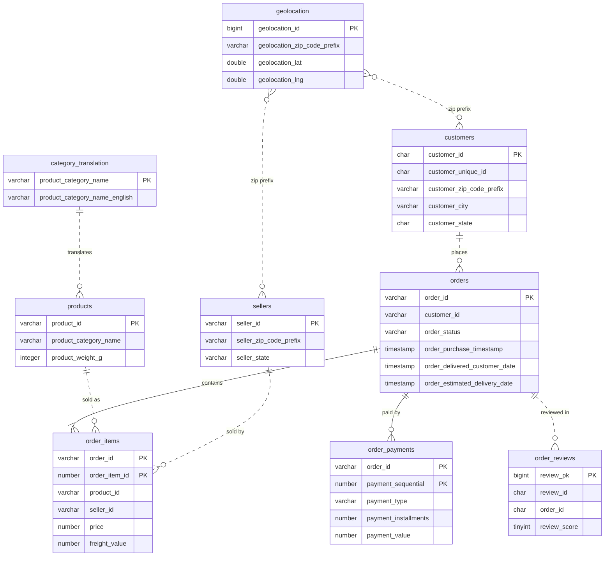

# ER diagram

Solid lines are real foreign keys inside one database. Dotted lines are logical links
across databases: no database enforces them, so orphans can exist. Silver and Gold
must check them. Key columns only; see `data-dictionary.md` for every column.

## Which database holds what

| Database | Tables | Why |
| --- | --- | --- |
| Oracle XE (EC2, Docker) | orders, order_items, order_payments | Transactions: the "ERP" |
| MySQL 8 (EC2, Docker) | customers, order_reviews | Customer-facing system: the "CRM" |
| PostgreSQL (AWS RDS) | products, sellers, category_translation, geolocation | Catalogue and reference data |

## Logical links across databases

| From | To | Join |
| --- | --- | --- |
| Oracle `orders.customer_id` | MySQL `customers.customer_id` | equality |
| Oracle `order_items.product_id` | PostgreSQL `products.product_id` | equality |
| Oracle `order_items.seller_id` | PostgreSQL `sellers.seller_id` | equality |
| MySQL `order_reviews.order_id` | Oracle `orders.order_id` | equality |
| PostgreSQL `products.product_category_name` | PostgreSQL `category_translation` | equality |
| MySQL `customers` / PostgreSQL `sellers` | PostgreSQL `geolocation` | zip code prefix (many rows per prefix) |
